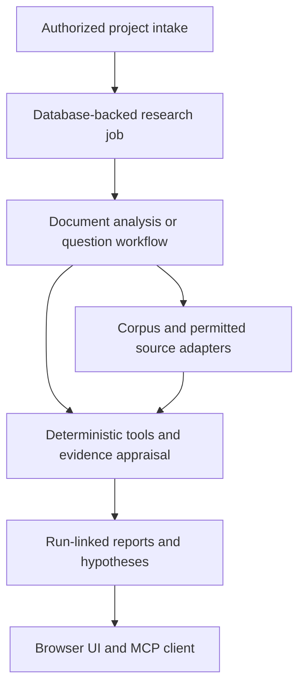

# Architecture

The attached master design sets the target. This branch starts from the supplied noesis_9 archive and preserves its FastAPI service, typed planner, worker queue, retrieval, evidence ledger, and UI.

SQLite stores project, document, job and research state in the hosted workspace. Content-addressed blobs live outside the web root. The optional database worker uses leases and retries. Research memory currently consists of a shared literature corpus and project-scoped belief events. PostgreSQL with row-level security, durable provenance snapshots, and a separately sandboxed parser are release gates.
